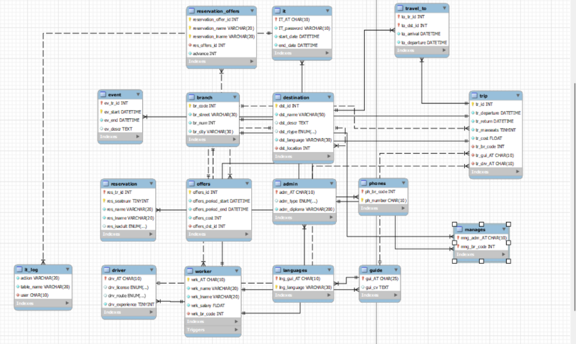

# Travel Agency Database

Relational database design for a travel agency, implemented in **MySQL / MariaDB**: schema, sample data (60,000+ rows), stored procedures and triggers.

Developed for the *Databases* course, Department of Computer Engineering & Informatics, University of Patras (3rd year), by a team of two (50% / 50%).

## What it covers
- **17 tables** with primary/foreign keys, `ON UPDATE / ON DELETE CASCADE`, `ENUM` types and defaults: branches, workers (with admin / driver / guide specialisations), trips, events, destinations, reservations, offers and an IT audit log.
- **60,000+ sample rows** (`reservation_offers`) plus hand-written data for the other tables.
- **Stored procedures**: hire a driver at the least-staffed branch, find trips by branch and date range, delete a worker (admins are protected), query advance payments and reservations per customer.
- **Triggers**: an audit trigger on `INSERT / UPDATE / DELETE` for five tables (logged into `IT_log`), plus two business rules: a worker's salary cannot be reduced, and a trip's dates and cost are frozen once it has reservations.

## ER diagram


## Repository structure
```
sql/
  schema_and_data.sql        creates the travel_agency database, tables and sample data
  procedures_triggers.sql    stored procedures and triggers
docs/
  ER_diagram.png             EER diagram (MySQL Workbench)
```

## How to run
Requires MySQL 8 or MariaDB 10.5+.
```bash
mysql -u root -p < sql/schema_and_data.sql
mysql -u root -p travel_agency < sql/procedures_triggers.sql
```
`schema_and_data.sql` starts with `DROP DATABASE IF EXISTS travel_agency`, so it recreates the database from scratch.

## Example queries
```sql
USE travel_agency;

-- trips of branch 123 departing in a period, with free seats
CALL FindingTrip(123, '1990-01-01', '2030-01-01');

-- customers whose advance payment is between 50 and 100
CALL PrePayment(50, 100);

-- hire a new driver (assigned automatically to the branch with the fewest drivers)
CALL addNewDriver('D9001', 'NIKOS', 'TEST', 1200.50, 'C', 'ABROAD', 5);

-- the salary trigger rejects this
UPDATE worker SET wrk_salary = 1 WHERE wrk_AT = 'D9001';
-- ERROR 1644 (45000): Cannot reduce worker salary
```

## Notes
- All personal data is fictional or anonymised. The large customer table was generated with random names.
- The procedures and triggers in this repository are corrected versions of the ones submitted with the course report, tested on MariaDB 10.11.

## Team

| Name | GitHub |
|---|---|
| Aristea Tempelopoulou | [@AristeaTemp](https://github.com/AristeaTemp) |
| Ilda Hunci | [@ildahun](https://github.com/ildahun) |

Two-person team project for the course "Databases" (University of Patras)

